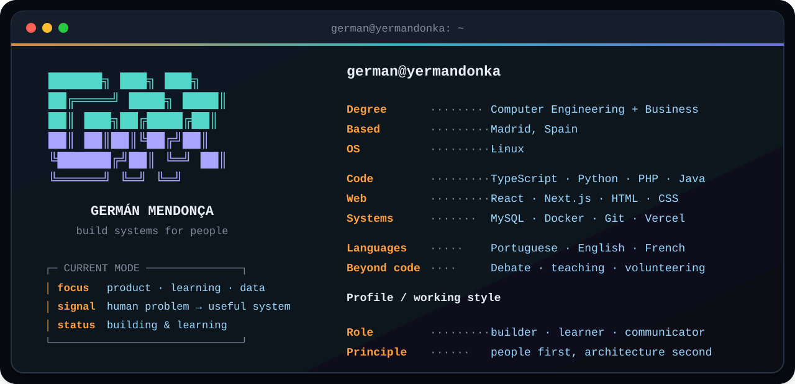

<div align="center">



### `connect --with-me`

[](mailto:yermandonka@gmail.com)
[](https://instagram.com/yermandonka)
[](https://github.com/Yermandonka?tab=repositories)

[](https://github.com/Yermandonka)

</div>

## `$ whoami`

Computer Engineering + Business Administration student. I turn human friction into useful systems—from learning tools and business platforms to data products and desktop software.

```text
person → problem → prototype → real use → iteration → product
```

<table>
<tr>
<td width="50%" valign="top">

### [⌨️ Bichimeca](https://github.com/Yermandonka/bichimeca)

Adaptive Spanish typing tutor built for accuracy before speed.

- **Architecture:** Next.js UI → pure TypeScript learning engine → versioned localStorage/IndexedDB.
- **Process:** metrics and tests first; curriculum, worlds and games afterwards.
- **Impact:** private, non-punitive practice without accounts or telemetry.
- **Stack:** `Next.js` `React` `TypeScript` `Vitest` `Playwright`

</td>
<td width="50%" valign="top">

### [🧭 Método Kiru](https://github.com/Yermandonka/metodokiru)

Gamified learning platform connecting students, mentors and families.

- **Architecture:** role-based PHP app → shared services → PDO → MySQL; Gemini exercise path.
- **Process:** learner MVP → mentor/family workflows → AI practice → Docker deployment.
- **Impact:** clearer goals for students and less repetitive preparation for mentors.
- **Stack:** `PHP` `MySQL` `JavaScript` `Gemini` `Docker`

</td>
</tr>
<tr>
<td width="50%" valign="top">

### [📊 BP Ringaos](https://github.com/Yermandonka/bpringaos)

Personal stories extracted from 310 Spanish-language debate tournaments.

- **Architecture:** Tabbycat APIs → Python discovery/scraping → normalized JSON → Vercel UI/API.
- **Process:** find instances → repair data → fuzzy-match people → automate daily updates.
- **Impact:** gives debaters a searchable memory of years of scattered results.
- **Stack:** `Python` `JavaScript` `Vercel` `Upstash Redis`

</td>
<td width="50%" valign="top">

### [🍽️ Bon Mos](https://github.com/Yermandonka/bonmos)

An editable digital storefront for a private chef.

- **Architecture:** static multipage frontend → serverless CRUD/media APIs → Vercel Blob.
- **Process:** showcase → simpler storage → hidden panel → mobile and image refinement.
- **Impact:** the chef controls the menu without code; clients reserve through WhatsApp.
- **Stack:** `HTML` `CSS` `JavaScript` `Vercel Functions` `Sharp`

</td>
</tr>
<tr>
<td width="50%" valign="top">

### [🎄 El Prohibido en Navidad](https://github.com/Yermandonka/elprohibidoennavidad)

Cooperative role-playing game about democratic health and communication.

- **Architecture:** JSON scenario deck → browser state machine → timed turns, decisions and effects.
- **Process:** static prototype → compatible card engine → table-tested rules and feedback.
- **Impact:** lets groups practise listening, trade-offs and disagreement through play.
- **Stack:** `HTML` `CSS` `JavaScript` `JSON` `Vercel`

</td>
<td width="50%" valign="top">

### [📖 Brigit](https://github.com/Yermandonka/brigit)

Community dictionary for proposing, defining and voting on new words.

- **Architecture:** PHP views → services/factories/DAOs → DTOs → relational MySQL model.
- **Process:** pages → roles and layers → voting → AJAX interactions and safer output.
- **Impact:** gives speakers an active role in documenting how language evolves.
- **Stack:** `PHP` `MySQL` `JavaScript` `AJAX` `Bootstrap`

</td>
</tr>
<tr>
<td width="50%" valign="top">

### [⏱️ Pomodoro de estudio](https://github.com/Yermandonka/_pomodoro-estudio-linux)

Quiet, always-available focus timer built specifically for Linux.

- **Architecture:** GTK model → Cairo/Pango UI → GStreamer/libnotify → atomic local JSON.
- **Process:** browser extension → WebKit wrapper → lightweight native rewrite.
- **Impact:** visible focus without cloud accounts, analytics or desktop disruption.
- **Stack:** `Python` `GTK3` `Cairo` `X11` `GStreamer`

</td>
<td width="50%" valign="top">

### [📈 Trading Sim](https://github.com/Yermandonka/trading-sim)

Quantitative trading laboratory using real data and fictitious points.

- **Architecture:** market APIs → indicators/ensemble → risk engine → SQLite → FastAPI dashboard.
- **Process:** signals → realistic costs/leverage → backtests → walk-forward validation.
- **Impact:** exposes weak strategies before real savings are placed at risk.
- **Stack:** `Python` `FastAPI` `pandas` `SQLite` `Raspberry Pi`

</td>
</tr>
<tr>
<td width="50%" valign="top">

### [🧵 Fibrilandos](https://github.com/Yermandonka/Fibrilandos)

My first web project and the baseline for everything that followed.

- **Architecture:** static pages → shared iframe header → contact journey → GitHub Pages.
- **Process:** page shell → navigation → identity → custom-domain configuration.
- **Impact:** a simple public presence—and the moment I began building for the web.
- **Stack:** `HTML` `CSS` `JavaScript` `GitHub Pages`

</td>
<td width="50%" valign="top">

### `git log --oneline`

What connects the work:

- behaviour before technology;
- complexity proportional to the problem;
- data that explains, not decorates;
- privacy and operator autonomy;
- iteration in the uncomfortable details.

</td>
</tr>
</table>

## `$ cat about.txt`

```text
Education     Computer Engineering + Business Administration
Achievement   3rd place · UCM Hackathon 2025
Communication British Parliamentary debater, judge and tournament staff
Experience    Teaching across ages · volunteering in education and social care
Languages     Portuguese: native · English: B2 · French: B1
```

<p align="center">
  
</p>

<div align="center">

### `$ ./build-something-human`

[](mailto:yermandonka@gmail.com)
[](https://instagram.com/yermandonka)

</div>
